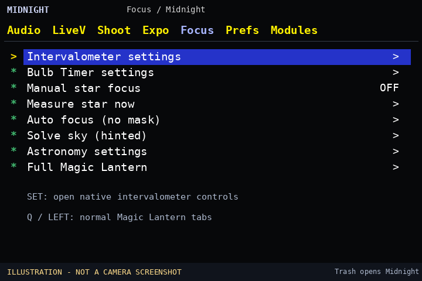
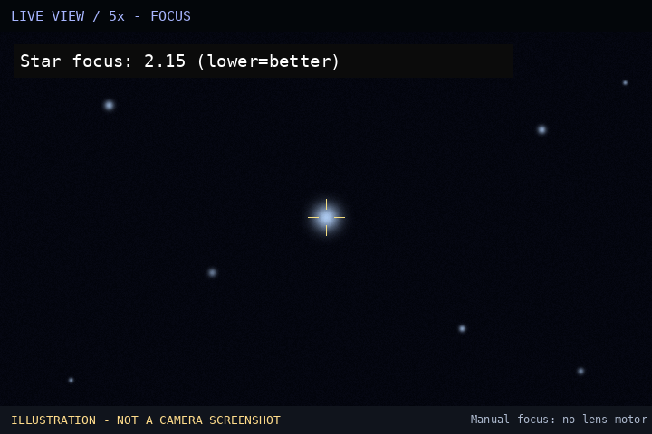
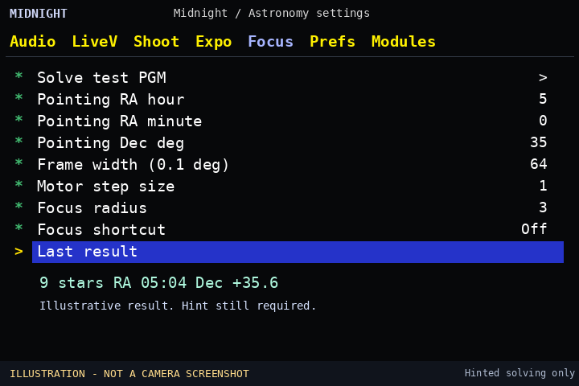

# Midnight

An astronomy-first interface for [Magic Lantern](https://github.com/reticulatedpines/magiclantern_simplified) on **Canon 600D (1.0.2)** and **Canon 6D (1.1.6)**.

**Experimental:** Not tested on physical cameras. Use a spare SD card and keep your existing working Magic Lantern card.

## Install

1. Check your camera version under **Canon MENU → Firmware Ver.**
2. Download the matching ZIP from the [Midnight release](https://github.com/mistrjirka/midnight/releases/tag/v0.2.2-alpha.1).
3. **Already have Magic Lantern?** Extract the **entire ZIP** onto a spare, bootable Magic Lantern SD card. Replace the existing Magic Lantern files. Do not rerun the installer.
4. **Fresh card?** Format it in the camera, extract the ZIP at the SD-card root, then use **MENU → Firmware Ver. → Firmware Update** in **M mode** to run **ML-SETUP.FIR**. Follow its instructions and restart. This installs the Magic Lantern boot setup, not a Canon firmware update.
5. Press **Trash/Delete** to open Magic Lantern, enable **astro** in **Modules**, and restart.

**After enabling astro, Trash opens Midnight first.** The original Magic Lantern menus are still available by pressing **Q/Left** or choosing **Full Magic Lantern**. Shutter, playback and essential Canon buttons remain unchanged.

## Midnight home menu

*The interface pictures in this README are labeled illustrations. Actual 600D QEMU screenshots have verified that the Midnight menu opens and the bundled plate-solving test completes.*

| Option | What it does |
|---|---|
| **Intervalometer settings** | Opens Magic Lantern's existing interval, start trigger and shot-count controls |
| **Bulb Timer settings** | Opens its long-exposure duration and display controls |
| **Manual star focus** | Toggles a live sharpness score. Works with manual lenses |
| **Measure star now** | Measures focus once without moving the lens |
| **Auto focus (no mask)** | Tries small electronic focus steps on a bright star |
| **Solve sky (hinted)** | Finds pointing coordinates using a rough initial sky position |
| **Astronomy settings** | Advanced focus settings, pointing hint, lens FOV and test image |
| **Full Magic Lantern** | Returns to the normal shooting menus |

### Manual focusing

1. Center a bright star and open **5×/10× Live View**.
2. Turn **Manual star focus** on, then leave the menu.
3. Adjust focus for the **lowest Star focus value**. It updates about once per second. Compare the *same star* at the *same zoom*.

**Bahtinov mask:** You can place the mask over the front of the lens and visually center the middle diffraction spike between the two diagonal spikes. Remove the mask before imaging. **Midnight does not yet measure spike alignment.** Its numeric focus score measures star size without a mask.

### Automatic focusing

Center a bright star at **5×/10×**, set the lens to **AF**, disable continuous/servo AF, then select **Auto focus (no mask)**. The routine attempts small movements and stops if communication or position confirmation fails. Start with **Motor step size = 1** and **Focus radius = 3** under **Astronomy settings**.

**Focus shortcut is ON by default:** DISP on the 600D, or the LCD-light button on the 6D. Press it in **photo Live View** to run autofocus with an electronic AF lens. With a manual-focus lens it toggles the **Star focus** readout instead. It does not override the button in menus, playback or movie mode.

To restore the original DISP/LCD-light behavior, open **Astronomy settings → Focus shortcut → Off**. You can instead select INFO or double half-press, but these may conflict with other controls.

**Physical camera testing remains necessary.** Autofocus motor behavior has not been verified on a real lens; pressing the enabled shortcut can move an electronic AF lens.

### Plate solving

Use **1× Live View** with enough visible stars. Set approximate **Pointing RA hour**, **RA minute** and **Dec deg** under **Astronomy settings**. Read the approximate location in Stellarium. Leave **Frame width (0.1 deg) = 0** to use an electronic lens's focal length, or enter the field width for a manual lens. Select **Solve sky (hinted)** and read **Last result** in the settings submenu.

**Blind solving is not ready yet.** A first all-sky index failed 3 of 5 synthetic test fields, so it is not enabled. The current solver uses Live View rather than long RAW exposures and may miss faint stars. The SD catalog now uses a small 2D sky index, so it reads only overlapping regions. [Blind-solving research](docs/BLIND_PLATE_SOLVING.md).

**Result display:** The Astronomy settings menu shows **Solved RA** (hh:mm:ss), **Solved Dec** (degrees/minutes/seconds), and **Last result** on separate rows. In the 600D QEMU test, the bundled sample solved to RA **05:04:56**, Dec **+35°36′00″**, using 9 stars. This has not been validated on real sky images. No star-marker overlay yet.

**Offline test:** Choose **Astronomy settings → Solve test PGM** with RA **05:00**, Dec **+35°**, and field width **64**. The included test image needs no sky or lens.

The ZIP includes **STARS.BIN** and **STARS.IDX**. The camera loads only nearby 5° × 5° sky regions from SD instead of scanning the full catalog. The index itself uses 10 KB RAM. You do not need to configure it.

## Troubleshooting

If the camera does not start, turn it off, remove the SD card and try booting without it. If necessary, remove and reinsert the battery without the card. Restore your known-working card. **Do not delete autoexec.bin from a bootable Magic Lantern card.**

[Development details](ASTRO_DEVELOPMENT.md) · [Build from source](scripts/build.sh)

Midnight and Magic Lantern: GPL-2.0-or-later. HYG star catalog: David Nash / Astronexus, CC BY-SA 4.0.

### Camera VM photograph tests

The Canon 600D QEMU emulator can solve a grayscale frame prepared from one real EOS 600D star-field preview: **16 matched stars, RA 05:20:28, Dec +33°52′12″**, close to an independent Astrometry.net result. Another photograph containing a prominent satellite/aircraft trail did **not** solve with Midnight's present on-camera star detector, although offline Astrometry.net can solve it. Neither photograph was uploaded to this repository. The test reads a processed PGM from the virtual SD card. Midnight does **not** yet read CR2 files or automatically take an exposure when Solve is selected.
