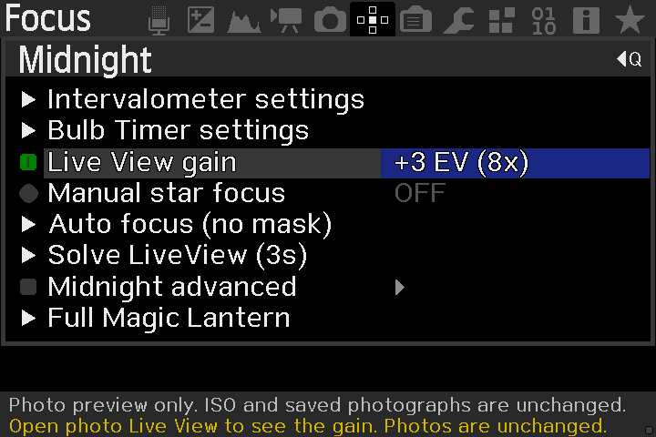
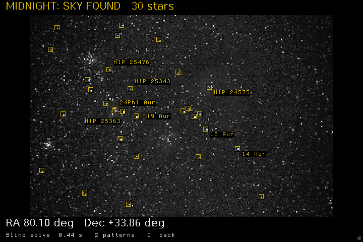
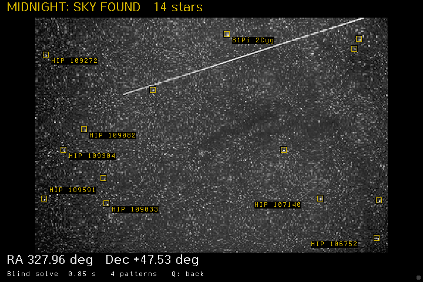

# Midnight

Astrophotography controls for [Magic Lantern](https://github.com/reticulatedpines/magiclantern_simplified) on **Canon EOS 600D (1.0.2)** and **Canon EOS 6D (1.1.6)**.

[Download v0.3.1-alpha.1](https://github.com/mistrjirka/midnight/releases/tag/v0.3.1-alpha.1) · [User guide](modules/astro/docs/USAGE.rst)

## Features

| Feature | What it does |
|---|---|
| **Blind plate solving** | Identifies the sky without position or focal-length inputs. Automatically shows coordinates and named stars over the solved frame. |
| **Live View gain** | Brightens the photo preview from Off to +6 EV (64x), without changing ISO or saved photographs. |
| **Manual star focus** | Shows a live star-size score to help you focus. |
| **Auto focus (no mask)** | Tries small electronic lens movements to focus on a bright star. |
| **Intervalometer and Bulb Timer** | Provides timed shooting and long-exposure controls. |

Focus tuning and previous results are under **Midnight advanced**. Other tools remain available through **Full Magic Lantern**.

## Plate-solving previews

Actual Canon 600D QEMU screenshots: **30 matched stars** in the clean photograph and **14** in the photograph with a bright trail.

  
  

These tests use prepared previews from real photographs. [Test details and limits](docs/QEMU_RESULTS.md).

## Quick use

- **Solve:** Open **1x photo Live View** and choose **Solve LiveView (3s)**. After a three-second settling delay, a successful solve opens the annotated frame. **Q** returns to Midnight. The delay does not take an exposure.
- **Focus:** Center a bright star at **5x/10x**, enable **Manual star focus**, and adjust for the lowest score. Compare the same star at the same zoom.
- **Gain:** Use **LEFT/RIGHT** on **Live View gain**. It also amplifies noise, so do not judge exposure from the boosted preview.

## Install

**Experimental:** 600D image-file solving and menu controls are QEMU-tested. The 6D is compile-tested only. Physical-camera operation and native gallery decoding remain unverified.

1. Download the full ZIP matching your camera and Canon firmware. Use a spare card and keep your working installation.
2. **Existing Magic Lantern card:** extract the entire ZIP at the card root. **Fresh card:** follow the [installation guide](modules/astro/docs/USAGE.rst#installation).
3. Press **Trash/Delete**, enable **astro** in **Modules**, and restart. Trash now opens Midnight.

**Focus shortcut:** 600D **DISP** / 6D **LCD-light** is enabled by default and can move an AF lens. Disable it under **Midnight advanced -> Star focus settings -> Focus shortcut**.

---

[User guide and recovery](modules/astro/docs/USAGE.rst) · [Build from source](scripts/build.sh) · [QEMU setup](docs/QEMU_DEVELOPMENT.md)

Midnight / Magic Lantern: GPL-2.0-or-later. HYG catalog: David Nash / Astronexus, CC BY-SA 4.0.
