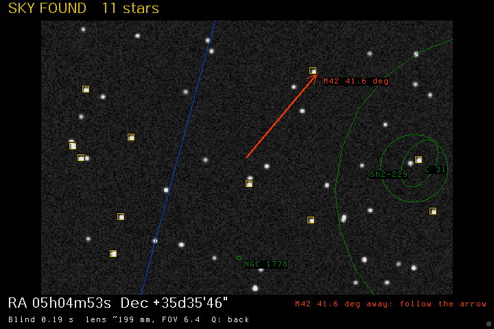

# Modular Midnight migration review

**Status: v0.4.0-alpha.1 experimental prerelease.**

## Scope

- Preserve Focus -> Midnight, intervalometer and Bulb Timer shortcuts,
  and the existing ML/SETTINGS/astro.cfg key names.
- Port the AstroML core, GPS/EXIF, target guidance and polar alignment.
- Support 600D (22.3 mm, 1.0.2) and 6D (35.8 mm, 1.1.6) at runtime.
- Fix Q -> SET in gallery and report Live View state errors precisely.
- Retain the original full-firmware ZIP and provide module-only updates.

## Acceptance gates

1. Reproducible ARM build and symbol checks for both cameras.
2. Host regressions against original Midnight code, with UBSan/ASan.
3. Simulated 600D playback YUV capture and actual key callback tests.
4. QEMU synthetic image solve where supported.
5. Physical Canon 600D album and Live View testing before promoting this
   branch to main or installing it as the user's working firmware.

Complete Canon album playback is unreliable in existing 600D QEMU.
The synthetic-file solver test cannot prove physical playback, autofocus
motor operation, Live View capture, or polar alignment.

## Build

PYTHON=python3 RUN_SLOW_TESTS=1 bash scripts/build.sh

This regenerates the polar sky index and the Midnight-layout reference index,
tests portable C against preserved original sources, and builds camera ZIPs.

## Measured acceptance on 2026-11-13

- 53 regular tests passed; 2 tests for original unpublished CR2 sources skipped.
- 10 additional slow solve-rate cases passed.
- 600D and 6D ARM firmware compiled. Both had zero missing module symbols
  across 81 imports.
- 600D QEMU booted with the new module and presented Focus -> Midnight,
  including the legacy timed-shooting links.
- Developer -> Solve image file opened the actual annotated LCD image with
  11 matched stars, RA 05h04m53s, Dec +35d35m46s and deep-sky target arrow.
  Emulator-reported solver elapsed time was 0.19 s.
- The synthetic source file is HYG-generated. It is not an actual on-camera
  Live View sensor frame or Canon album preview.
- Canon QEMU reported 652 KB free during the solve. Watch real-camera memory
  pressure, especially when other Magic Lantern modules are enabled.

## Remaining physical-camera checks

1. Test Play -> Q -> SET in a full-screen 600D photo without allowing the
   Canon SET+MainDial exposure-adjust shortcut to activate.
2. Check Last solve -> Status after any failure. The error must persist.
3. Test Solve Live View with actual 1x photo Live View. Distinguish an inactive
   view from a changed view. Do not interpret 3 seconds as an exposure.
4. Confirm star-detection sensitivity, frame geometry, lens motion guards,
   and available RAM with a normal set of enabled ML modules.
5. Validate polar alignment with human-supervised movement before advising
   motorized mount control.

The release is experimental. Merging source changes does not update the
firmware already installed on a camera.

Install and recovery instructions: [INSTALL.md](INSTALL.md).

C audit: [C_CODE_REVIEW.md](C_CODE_REVIEW.md).
