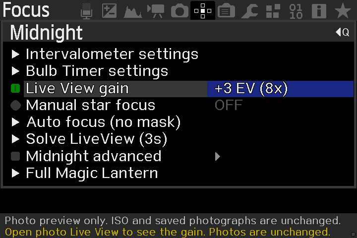
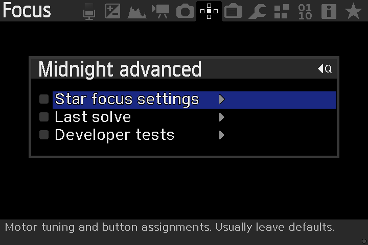

# Canon 600D QEMU acceptance results

> **Historical reference:** The procedures and results below were recorded
> with the earlier monolithic Midnight module. For the AstroML-based migration,
> see [modular migration review](MODULAR_MIGRATION.md).

The original `IMG_7975.CR2` and `IMG_6446.CR2` passed the compiled ARM solver in Canon EOS 600D firmware 1.0.2. No pointing or image-scale hints were supplied. The generic index was built only from HYG star data.

| Frame | Stars | RA degrees | Dec degrees | Previous fresh-card repeat | Release-source rerun |
|---|---:|---:|---:|---:|---:|
| IMG_7975 | 30 | 80.1032 | +33.8599 | 434 ms | 420 ms |
| IMG_6446 with trail | 14 | 327.9574 | +47.5273 | 836 ms | 846 ms |

A blank image produced `0 stars; need at least 8`, with empty coordinates. The latest test captures were reviewed, including the blank rejection screen. The firmware timer includes image capture, detection, trail filtering, directory loading and solve. It excludes subsequent name lookup and rendering, and it is not a hardware timing prediction.

## Provenance

Release-source module: 44,852 bytes, SHA256 `ba27e804b014bd3ac902aba01eab4b2cd45ffbed21b6a2c9708788a9afacccc4`.

A clean rebuild of the identical source produced SHA256 `07b1aa2da98afc47656d5cead629c5bc01b24a0605db4603c29802b5cbdf539f`. Its only byte differences from the tested module are six bytes in the embedded build timestamp. Executable code, data and relocation bytes are identical. CI builds have their own timestamps and package hashes.

Previous screenshot module: 44,684 bytes, SHA256 `7422f45d9b579bc0030c2cee325f44425b5e5a774daa930a8ee0dfffd39a67fa`. The two README screenshots show this earlier successful build. Their pixels are preserved; PNG compression may differ from the original capture files.

The release-source change adds automatic frozen-frame rendering to Live View after a verified solution. The image-file workflow already displayed it automatically. The same solver and renderer passed both frames after the change. Actual Live View sensor acquisition and the complete native Canon playback route remain unverified.

The test emulator SHA256 was `e9fe2871da12888c44def07cd0641fd44e916cb829354701114f1fcfff6f6ce4`, the retained `qemu-system-arm-rom0fix` executable from Development Sandbox. The source was built in the persistent sandbox; a disposable local copy of that emulator was used because the original photographs were mounted in the conversation workspace.

## Exact test scope

Original CR2 -> original embedded JPEG -> thumbnail -> 360x240 grayscale PGM -> virtual SD -> ARM solver -> actual Canon LCD framebuffer. The preview background is reloaded from the original frame after solving, preserving the visible bright trail while excluding it from detection.

The tested action is **Midnight -> Astronomy settings -> Solve image file**. The raw-photo decoding step happens before this test. Physical cameras, autofocus motors, 6D emulation, and native Play -> Q -> SET album handling have not been validated. The 6D package is compile-tested only.

The old 210-second timeout and failed top-32 candidate tests concern the retired `astro_blind` voting implementation, not the shared-field `astro_sky` implementation in this release. Do not reintroduce the old module object or BLQ database.

## v0.3.1-alpha.1 quick-menu and gain update

The updated module was loaded in actual Canon 600D 1.0.2 QEMU. All eight
Midnight quick controls fit on one screen. Star focus settings, Last solve
and Developer tests open correctly under Midnight advanced.

The gain callback was driven through the camera menu from Off to +6 EV,
with an additional RIGHT press at maximum, then back to Off with an
additional LEFT press. Logged native photo-gain values were
`2048, 4096, 8192, 16384, 32768, 65536, 32768, 16384, 8192, 4096, 2048, 1024`.
The movie-gain getter remained `1024` and Canon raw ISO remained `0`
throughout. A fresh-card repeat with the final module also passed.

The relocated Developer tests -> Solve image file action solved the
bundled synthetic PGM with **22 verified stars**, then opened the annotated
frame automatically. Q returned to Midnight. The earlier real-photo
30/14-star results above remain the v0.3.0 acceptance evidence, not new
sensor tests. The sky solver, capture/solve routine and result worker are
unchanged in this menu-only update.

The script `modules/astro/tests/test_gain_menu.py` extracts the production
gain callback and tests it against injected ML state. It verifies the
movie-mode/busy guards, endpoints and absence of ISO/movie-gain writes.
It is a policy test, not a substitute for QEMU. The emulator's movie-mode
switch did not provide a stable ML menu for an end-to-end movie guard
check, so that behavior is not claimed as visually verified. Sensor
brightening and physical-camera behavior remain unverified. The 6D is
build/symbol checked, not emulated.
